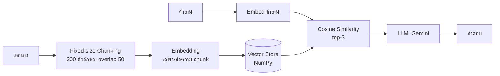
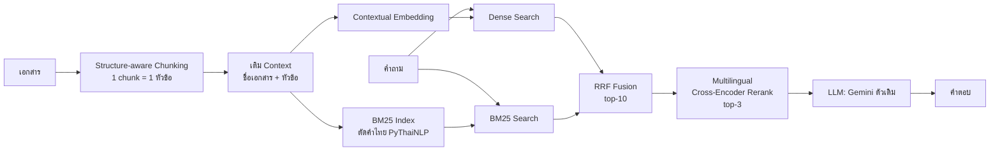

# RAG Assignment: Basic RAG vs Improved RAG

งานนี้มีระบบ RAG (Retrieval-Augmented Generation) สองแบบ ใช้ถามตอบจากเอกสารระเบียบภายในบริษัทสมมติ 6 ฉบับ ได้แก่ การเดินทางต่างประเทศ การเดินทางในประเทศ การลา อุปกรณ์ IT สวัสดิการสุขภาพ และการฝึกอบรม

| ข้อ | เนื้อหา | อยู่ที่ |
|---|---|---|
| (1) | ระบบ RAG พื้นฐานตามสไลด์หน้า 22, 25 | [`part1_basic/`](part1_basic/) |
| (2) | ระบบที่ปรับปรุงส่วน chunking, embedding, search, scoring และ reranking | [`part2_improved/`](part2_improved/) |
| (3) | คำอธิบายความแตกต่าง ว่าดีขึ้นอย่างไรและเพราะอะไร | README นี้ ([ไปที่หัวข้อ](#3-ความแตกต่างระหว่าง-1-และ-2)) |
| — | สคริปต์วัดผลเปรียบเทียบสองระบบเป็นตัวเลข | [`evaluate.py`](evaluate.py) |

> **ทั้งสองระบบใช้ LLM ตัวเดียวกัน** คือ Google Gemini ผ่านฟังก์ชัน `generate_answer_with_llm()` ซึ่งเหมือนกันทุกบรรทัด ส่วนที่ปรับปรุงทั้งหมดอยู่ในขั้น Retrieval ตามที่โจทย์กำหนด

---

## โครงสร้างไฟล์

```
RAG_Assignment/
├── README.md
├── evaluate.py                  # วัดผล Retrieval: Part 1 vs Part 2 (+ ablation)
├── part1_basic/
│   ├── rag_part1_basic.py       # (1) Basic / Generic RAG
│   ├── sample_documents.py
│   └── requirements.txt
└── part2_improved/
    ├── rag_part2_improved.py    # (2) Improved RAG
    ├── sample_documents.py
    └── requirements.txt
```

## วิธีรัน

```bash
pip install -r part2_improved/requirements.txt   # ครอบคลุม Part 1 ด้วย

# (ถ้าต้องการให้ LLM ตอบจริง ถ้าไม่ตั้งค่าไว้ ระบบจะแสดง prompt ที่จะส่งให้ LLM แทน)
export GOOGLE_API_KEY="your-key"        # Windows: set GOOGLE_API_KEY=your-key
# export GEMINI_MODEL="gemini-2.5-flash"   # ค่าเริ่มต้น ใช้เหมือนกันทั้งสองระบบ

python part1_basic/rag_part1_basic.py
python part2_improved/rag_part2_improved.py
python evaluate.py                     # พิมพ์ตารางเปรียบเทียบ และบันทึกที่ results/eval_results.md
```

ครั้งแรกที่รัน ระบบจะดาวน์โหลดโมเดลจาก Hugging Face ได้แก่ embedding ขนาดประมาณ 470 MB และ cross-encoder ขนาดประมาณ 470 MB

---

## (1) Basic RAG: Generic RAG ตามสไลด์



| ขั้น | วิธีที่ใช้ |
|---|---|
| Chunking | ตัดทุก 300 ตัวอักษร ซ้อนกัน 50 ตัวอักษร (`fixed_size_chunking`) |
| Embedding | `paraphrase-multilingual-MiniLM-L12-v2` embed เฉพาะข้อความใน chunk |
| Vector store | NumPy array เก็บในหน่วยความจำ |
| Retrieval | Cosine similarity คำนวณจาก dot product ของ vector ที่ normalize แล้ว เลือก 3 อันดับแรก |
| Generation | ใส่ 3 chunks ลงใน prompt แล้วส่งให้ Gemini |

## (2) Improved RAG



| ขั้น | Part 1 | Part 2 |
|---|---|---|
| **Chunking** | ตัดตามจำนวนตัวอักษร | ตัดตามโครงสร้างเอกสาร (`ข้อ N`, `N.`, bullet `-`) |
| **Context ของ chunk** | ไม่มี | ใส่ `เอกสาร: <ชื่อเอกสาร>` นำหน้า ส่วนบรรทัดแรกของ chunk คือหัวข้อย่อยของตัวเองเสมอ |
| **Embedding** | `embed(chunk)` | `embed(context + chunk)` (Contextual Embedding) |
| **Search** | Dense อย่างเดียว | Dense + BM25 (Hybrid) |
| **Scoring/Fusion** | Cosine score | Weighted Reciprocal Rank Fusion |
| **Reranking** | ไม่มี | Multilingual Cross-Encoder (`mmarco-mMiniLMv2`) อ่าน (คำถาม, context+chunk) คู่กัน |
| **Two-stage** | ดึง 3 ส่งให้ LLM 3 | ดึงมา 10 แล้ว rerank คัดเหลือ 3 |
| **Prompt** | ระบุ doc_id | ระบุชื่อเอกสาร เพื่อให้ LLM อ้างอิงแหล่งที่มาได้ |
| **LLM** | Gemini | Gemini ตัวเดียวกัน |

---

## (3) ความแตกต่างระหว่าง (1) และ (2)

### 3.1 Chunking: จากตัดตามจำนวนตัวอักษร เป็นตัดตามโครงสร้างเอกสาร

**ต่างตรงไหน:** Part 1 ตัดข้อความทุก 300 ตัวอักษรโดยไม่ดูเนื้อหา ส่วน Part 2 อ่านโครงสร้างเอกสารก่อน แล้วให้ 1 chunk เท่ากับ 1 หัวข้อย่อย เช่น "2. ลาป่วย" พร้อม bullet ทั้งหมดที่อยู่ใต้หัวข้อนั้น ถ้าหัวข้อใดยาวเกิน 400 ตัวอักษร ระบบจะแบ่งตามบรรทัด และใส่บรรทัดหัวข้อนำหน้าทุกชิ้น

**ปัญหาของ Part 1 ที่พบจริงในเอกสารชุดนี้** (ได้จากการรันฟังก์ชัน chunking ของทั้งสองส่วน):

| ปัญหา | ตัวอย่างจาก Part 1 |
|---|---|
| ตัดกลางคำ | chunk แรกจบด้วย `"...แบ่งออกเป็นประเภทต่างๆ ดั"` และ chunk หนึ่งขึ้นต้นด้วย `"ักงานทั่วไป: ..."` |
| ตัวเลขหลุดจากสิ่งที่มันอธิบาย | chunk หนึ่งจบด้วย `"ระดับพนักงานทั่วไป: ได้รับคอมพิวเตอร์โน้ตบุ๊กมูลค่าไม่เกิ"` ตัวเลข 35,000 จึงหลุดไปอยู่ chunk ถัดไป อีก chunk หนึ่งจบด้วย `"ระดับผู้อำนวยการขึ้นไป: เบิกได้ไม่เกิน"` โดยไม่มีตัวเลข 2,000 |
| คำสำคัญขาด | chunk ที่มีคำตอบ "พนักงานทั่วไป 500 บาทต่อเดือน" ขึ้นต้นด้วย `"ศัพท์ - ระดับ..."` คือคำว่า "ค่าโทรศัพท์" ถูกตัดเหลือแค่ "ศัพท์" ทำให้ chunk นี้ไม่มีคำว่า "โทรศัพท์" ครบสักคำ |
| chunk ขยะ | มี chunk ที่มีแค่ `"หาร"` และ `"งบริษัท"` เกิดจากเศษท้ายเอกสารที่เหลือหลัง overlap ไม่มีความหมาย แต่ยังกินที่ใน index |
| whitespace ปน | มี `"\n    \n    "` ติดอยู่ใน chunk ทำให้ embedding มี noise |

Part 1 ได้ทั้งหมด **20 chunks** โดยมี 2 chunks ที่เป็นขยะ ส่วน Part 2 ได้ **18 chunks** และทุก chunk เป็นหัวข้อที่สมบูรณ์ เช่น

```
เอกสาร: นโยบายการลาของพนักงาน
2. ลาป่วย (Sick Leave)
พนักงานมีสิทธิ์ลาป่วยได้ 30 วันต่อปี โดยได้รับค่าจ้างเต็ม
หากลาป่วยติดต่อกันเกิน 3 วัน ต้องมีใบรับรองแพทย์
```

**ดีขึ้นอย่างไร และเพราะเหตุใด:** embedding ของ chunk หนึ่งคือค่าเฉลี่ยความหมายของทุก token ใน chunk นั้น ถ้า chunk มีครึ่งหลังของหัวข้อ A ปนกับครึ่งแรกของหัวข้อ B vector จะอยู่กึ่งกลางระหว่างสองเรื่องและไม่ใกล้คำถามเรื่องใดเลย เมื่อ 1 chunk มีแค่ 1 เรื่อง vector จะชี้ไปที่เรื่องนั้นชัดเจน และ LLM ได้คำตอบที่ครบในชิ้นเดียว เพราะหัวข้อ เงื่อนไข และตัวเลขอยู่ด้วยกัน

### 3.2 Embedding: Contextual Embedding

**ต่างตรงไหน:** Part 1 embed แค่ข้อความใน chunk ส่วน Part 2 embed `"เอกสาร: <ชื่อเอกสาร>\n<หัวข้อ>\n<เนื้อหา>"` ตามแนวคิด *Contextual Retrieval* ของ Anthropic ที่ให้เติมบริบทกำกับแต่ละ chunk ก่อน embed

**ดีขึ้นอย่างไร:** เอกสารชุดนี้มีข้อความที่คล้ายกันมากแต่อยู่คนละบริบท เช่น

- `ค่าที่พัก: เบิกได้ไม่เกินคืนละ 150 USD` อยู่ในเอกสาร**ต่างประเทศ**
- `ค่าที่พัก: เบิกได้ไม่เกินคืนละ 1,200 บาท` อยู่ในเอกสาร**ในประเทศ**
- `150,000 บาท` ปรากฏทั้งใน "วงเงินเดินทางต่างประเทศ" และ "ประกันสุขภาพคู่สมรส"

ใน Part 1 chunk `"ค่าที่พัก: ...1,200 บาท"` ไม่มีคำว่า "ในประเทศ" อยู่เลย จึงแยกไม่ออกว่าเป็นค่าที่พักแบบไหน ส่วนใน Part 2 ทุก chunk มีชื่อเอกสารติดอยู่ เมื่อถามว่า "ไปทำงานต่างจังหวัด ค่าโรงแรม..." vector ของ chunk ในประเทศจึงใกล้คำถามกว่า

**เพราะเหตุใด:** chunk ที่ถูกตัดออกมาจากเอกสารจะเสียข้อมูลว่า "เรื่องนี้มาจากไหน" การเติมบริบทกลับเข้าไปเป็นวิธีที่ถูกที่สุด เพราะทำครั้งเดียวตอน index และไม่ต้องเปลี่ยนโมเดล ใน production อาจให้ LLM เขียนสรุปบริบทแทนการใช้ชื่อเอกสาร

### 3.3 Search: Hybrid Search (Dense + BM25)

**ต่างตรงไหน:** Part 1 ใช้ dense vector อย่างเดียว ส่วน Part 2 ใช้ BM25 (ค้นด้วยคำ) ควบคู่ด้วย แล้วรวมผลสองทาง

| | Dense (Bi-encoder) | BM25 (Sparse) |
|---|---|---|
| เก่งเรื่อง | ความหมาย, คำพ้อง ("โรงแรม" ≈ "ที่พัก") | คำตรงตัว, ตัวเลข, ศัพท์เฉพาะ ("ลาคลอด", "USD", "150000") |
| อ่อนเรื่อง | ตัวเลขและคำเฉพาะ เพราะ vector จำได้ไม่แม่น | คำที่ไม่ตรงกับเอกสาร |

BM25 ภาษาไทยมีปัญหาเฉพาะคือภาษาไทยไม่เว้นวรรคระหว่างคำ Part 2 จึง:

- ใช้ **PyThaiNLP (newmm)** ตัดคำ เช่น `"ค่าที่พักต่างประเทศเบิกได้เท่าไหร่"` เป็น `ค่า | ที่พัก | ต่างประเทศ | เบิก` (ตัดคำ stopword อย่าง "ได้" และ "เท่าไหร่" ออก) ถ้าไม่ได้ติดตั้ง PyThaiNLP จะใช้ character bigram แทน
- normalize ตัวเลข เช่น `150,000` เป็น `150000` เพื่อให้คำถามที่พิมพ์ "150000" ยัง match ได้

**ดีขึ้นอย่างไร และเพราะเหตุใด:** สองวิธีพลาดคนละแบบ เมื่อรวมกัน ข้อผิดพลาดของวิธีหนึ่งจึงถูกอีกวิธีชดเชย เช่น คำถาม "ลาคลอดได้กี่วัน" BM25 จะให้คะแนนสูงมากกับ chunk ที่มีคำว่า "ลาคลอด" เพราะเป็นคำหายาก (IDF สูง) แม้ dense อาจสับสนกับหัวข้อลาป่วยหรือลากิจที่มีรูปประโยคเหมือนกัน

### 3.4 Scoring: Reciprocal Rank Fusion (RRF)

`RRF(d) = Σ wᵢ / (60 + rankᵢ(d))`

**ทำไมไม่บวก score ตรงๆ:** cosine อยู่ในช่วง -1 ถึง 1 แต่ BM25 ไม่มีขอบบน และเปลี่ยนไปตามคำถาม ถ้าบวกกันตรงๆ BM25 จะกลบ dense เสมอ RRF ใช้แค่ "อันดับ" จึงไม่ต้องปรับ scale และ chunk ที่ติดอันดับดีทั้งสองวิธีจะขึ้นมาบนสุด ใน Part 2 ให้น้ำหนักทั้งสองวิธีเท่ากันที่ 0.5/0.5

### 3.5 Reranking: Multilingual Cross-Encoder

**ต่างตรงไหน:** Part 1 ไม่มีขั้นนี้ ส่วน Part 2 ใช้กระบวนการสองขั้น

1. **Retrieval (เร็ว):** Hybrid search ดึงมา 10 chunks เพื่อให้ recall สูง
2. **Rerank (แม่น):** Cross-encoder อ่านคำถามคู่กับแต่ละ chunk **พร้อมกัน** ใน transformer ตัวเดียว ให้คะแนนใหม่ แล้วเลือก 3 อันดับแรกส่งให้ LLM

**เพราะเหตุใดจึงแม่นกว่า:** bi-encoder ที่ใช้ใน dense search บีบคำถามและ chunk ให้เป็น vector แยกกันก่อนนำมาเทียบ ข้อมูลระดับคำจึงหายไป ส่วน cross-encoder ให้ทุกคำในคำถามทำ attention กับทุกคำใน chunk ได้โดยตรง จึงเห็นว่า "พนักงาน**ทั่วไป**เบิกค่าโทรศัพท์" ตรงกับบรรทัด "ระดับพนักงานทั่วไป: 500 บาท" ไม่ใช่บรรทัดของผู้จัดการ แต่ cross-encoder ช้ากว่ามาก จึงใช้เฉพาะกับ 10 ตัวเลือกเท่านั้น

**การเลือกโมเดล:** โค้ดตั้งต้นใช้ `cross-encoder/ms-marco-MiniLM-L-6-v2` ซึ่ง**ฝึกด้วยภาษาอังกฤษเท่านั้น** ถ้าให้คะแนนข้อความภาษาไทย คะแนนแทบจะสุ่ม และอาจทำให้ผลแย่ลงกว่าไม่ rerank Part 2 จึงเปลี่ยนเป็น `cross-encoder/mmarco-mMiniLMv2-L12-H384-v1` ซึ่งฝึกบน mMARCO (MS MARCO ที่แปลเป็น 14 ภาษา) และใช้ backbone แบบ multilingual ที่รองรับภาษาไทย นอกจากนี้ยังส่ง `context + chunk` ให้ reranker เพื่อให้รู้ว่า chunk มาจากเอกสารใด

### 3.6 สรุปภาพรวม

| ด้าน | Part 1 | Part 2 | ผลที่คาดว่าจะได้ |
|---|---|---|---|
| คุณภาพ chunk | ตัดกลางคำ มี chunk ขยะ | 1 chunk = 1 หัวข้อ | embedding สื่อความหมายตรงขึ้น LLM ได้ข้อมูลครบ |
| แยกเรื่องที่คล้ายกัน | ทำได้ยาก (ที่พักในประเทศกับต่างประเทศ) | มีชื่อเอกสารกำกับ | ลดการดึงผิดเอกสาร (Doc@1 สูงขึ้น) |
| ตัวเลข/คำเฉพาะ | พึ่ง vector อย่างเดียว | BM25 + ตัดคำไทย | ดึง chunk ที่มีคำ/ตัวเลขตรงได้ดีขึ้น |
| ลำดับผลลัพธ์ | cosine score | RRF แล้วตามด้วย cross-encoder | คำตอบอยู่อันดับ 1 บ่อยขึ้น (Answer@1, MRR สูงขึ้น) |
| Context ที่ส่งให้ LLM | ยาวกว่าและมี noise | สั้นกว่าและตรงกว่า | LLM ตอบแม่นขึ้น และ hallucinate น้อยลง |

**ข้อแลกเปลี่ยน (trade-offs) ของ Part 2:**

- ช้ากว่า เพราะต้องรัน BM25 และ cross-encoder เพิ่มอีก 10 คู่ต่อคำถาม ซึ่งเอกสารขนาดนี้ยังเร็วพอ
- ต้องดาวน์โหลดโมเดล reranker เพิ่มอีกประมาณ 470 MB
- Structure-aware chunking พึ่งรูปแบบหัวข้อ (`ข้อ N`, `N.`) ถ้าเอกสารไม่มีโครงสร้าง ระบบจะ fallback เป็นการแบ่งตามบรรทัด
- BM25 ที่เขียนเองวน loop ทุก chunk ถ้าเอกสารมีจำนวนมากควรเปลี่ยนไปใช้ OpenSearch, Elasticsearch หรือ inverted index

### 3.7 ผลการวัดเชิงตัวเลข

`evaluate.py` วัดเฉพาะขั้น retrieval ด้วยชุดคำถาม 16 ข้อ ทุกระบบส่ง 3 chunks ให้ LLM เท่ากัน ชุดคำถามมีทั้งแบบที่ใช้คำตรงกับเอกสาร แบบที่ถามด้วยคำต่างจากเอกสาร (เช่น "ค่าโรงแรม", "ขับรถตัวเอง", "ตัดแว่น") และแบบที่ตัวเลขหรือคำซ้ำกันข้ามเอกสาร

- **Answer@3** คือ 3 chunks ที่ส่งให้ LLM มีคำตอบอยู่หรือไม่ ถ้าไม่มี LLM ก็ตอบถูกไม่ได้
- **Answer@1 / MRR** วัดว่าคำตอบอยู่อันดับต้นแค่ไหน
- **Doc@1** วัดว่าอันดับ 1 มาจากเอกสารที่ถูกต้องหรือไม่

สคริปต์ทำ **ablation** ด้วย คือเพิ่มเทคนิคทีละขั้น A → B → C → D เพื่อให้เห็นว่าแต่ละเทคนิคช่วยมากน้อยเท่าไร หลังรัน `python evaluate.py` ผลจะถูกบันทึกที่ `results/eval_results.md`

---

## อ้างอิง

- Anthropic, *Introducing Contextual Retrieval* (2024): https://www.anthropic.com/news/contextual-retrieval
- Robertson & Zaragoza, *The Probabilistic Relevance Framework: BM25 and Beyond* (2009)
- Cormack et al., *Reciprocal Rank Fusion outperforms Condorcet and individual Rank Learning Methods* (SIGIR 2009)
- Bonifacio et al., *mMARCO: A Multilingual Version of the MS MARCO Passage Ranking Dataset* (2021)
- PyThaiNLP: https://github.com/PyThaiNLP/pythainlp
